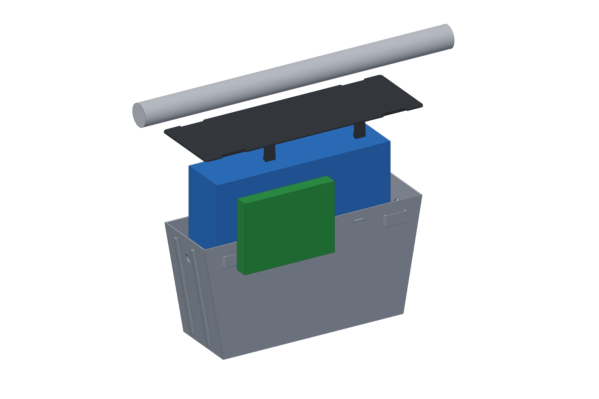

# Корпус АКБ + BMS + контроллер для электровелосипеда (Виталик)

Трапециевидный корпус в треугольник рамы. Подвешивается под верхнюю трубу на двух ремнях, как подрамная сумка.
Модель параметрическая, на [CadQuery](https://cadquery.readthedocs.io): все размеры заданы в начале `enclosure.py`.


| Разнесённый вид | Разрез (ближняя стенка убрана) |
|---|---|
|  |  |

## Исходные данные

| Что | Размер | Откуда |
|---|---|---|
| Корпус по эскизу | верх 340, низ 280, высота 160, ширина 100 мм | эскиз 1 |
| Аккумулятор 18650 | 270 × 110 × 73 мм | замер |
| BMS (на грани батареи) | 140 × 105 × 20 мм | замер, фото |
| Контроллер | 172 × 83 × 42 мм, ушки по 12 мм (итого 196) | эскиз 3 |
| Рёбра на торцах A/B и дне C | высота 5 мм, просвет 35 мм / отступ 20 мм | эскиз 1 |

## Компоновка

- **Сверху отсек АКБ.** Батарея стоит **на боку**: поперёк велосипеда она занимает 73 мм вместо 110, поэтому остаётся больше места коленям.
  BMS остаётся прикрученной к батарее, как сейчас, и оказывается сбоку. Вместе с BMS это 93 мм поперёк и 110 мм по высоте.
- **Съёмная полка-перегородка** (отдельная деталь). Лежит на уступах стенок, у торца B есть вырез под силовые провода.
- **Снизу отсек контроллера.** Контроллер лежит плашмя, ушками на 4 винта M4 ко дну. Отверстия в дне сделаны пазами ±6 мм, потому что шаг отверстий ещё не известен.
  Провода выходят к торцу B, там оставлено 47 мм на изгиб.
- **Крышка сверху на 4 защёлках** (snap-fit, без винтов). Изнутри у неё центрирующий буртик.
- **Подвес:** 4 петли под ремень или липучку 25 мм на длинных стенках. В свесе крышки на этих местах сделаны вырезы.
- **Выводы.** На торце B: сальник M20 под жгут контроллера, M16 под силовые провода, гнездо зарядки Ø16 (GX16). На торце A: мембранный клапан M12.

### Итоговые размеры (из `out/dimensions.txt`)

Ширина и высота **пересчитываются по содержимому** и получаются немного больше эскиза:

- **ширина 103 мм** (эскиз — 100): батарея с BMS 93 + зазоры 2×2 + стенки 2×3;
- **высота 171 мм** (эскиз — 160): контроллер 42 + полка + батарея на боку 110 + зазоры, дно и крышка.

Если 160 × 100 — жёсткое ограничение, есть варианты, их надо выбрать вместе (см. ниже).

## Файлы

| Файл | Что это |
|---|---|
| `enclosure.py` | модель: параметры, геометрия, проверки, экспорт |
| `render_preview.py` | картинки превью (three.js в headless Chromium) |
| `out/body.stl`, `lid.stl`, `shelf.stl` | детали для печати |
| `out/*.step` | детали для SolidWorks, FreeCAD и т. п. |
| `out/assembly.step` | сборка с макетами батареи, BMS и контроллера |
| `out/dimensions.txt` | габариты и проверка пересечений |

## Как пересобрать

```bash
pip install -r requirements.txt
```

```bash
python enclosure.py
```

```bash
python render_preview.py
```

Размеры меняются в блоке `ПАРАМЕТРЫ` в начале `enclosure.py`. После пересборки загляните в `out/dimensions.txt`:
там будет видно, если что-то с чем-то пересеклось.

## Печать

- Материал: **PETG или ASA**. PLA на солнце и рядом с нагретым контроллером поведёт. Стенки 3 мм — это 4–5 периметров, заполнение 25–30 %.
- **Корпус длиной 344 мм не влезает в стол 256×256** (Bambu/Prusa). Есть два пути:
  принтер со столом от 350 мм или разрезать корпус пополам с замком-стыком (могу добавить в модель).
- Защёлки печатаются вертикально, вместе с крышкой: так лепестки гнутся вдоль слоёв и не ломаются.

## Что нужно уточнить

1. **Шаг отверстий в ушках контроллера** (расстояние между двумя отверстиями на одном ушке). Сейчас стоит 55 мм, а в дне сделаны пазы с запасом.
2. **Ширина 103 и высота 171 мм — нормально?** Если нужно строго 100 мм по ширине, можно снять BMS с грани батареи и поставить её в торец отсека.
   Тогда ширина будет около 83 мм, но придётся перекладывать балансировочные провода.
3. **Рёбра на торцах и дне.** Я понял их как направляющие для ремня или рёбра жёсткости. Если они для чего-то другого (например, полозья, по которым корпус задвигается в крепление), напишите.
4. **Диаметр верхней трубы и как идут ремни**: только вокруг трубы или ещё и вокруг подседельной.
5. **Где нужна кнопка включения и разъём зарядки** — сейчас они на торце B.
6. **Как делаем больший стол**: есть ли принтер от 350 мм, или режем корпус на две части.
