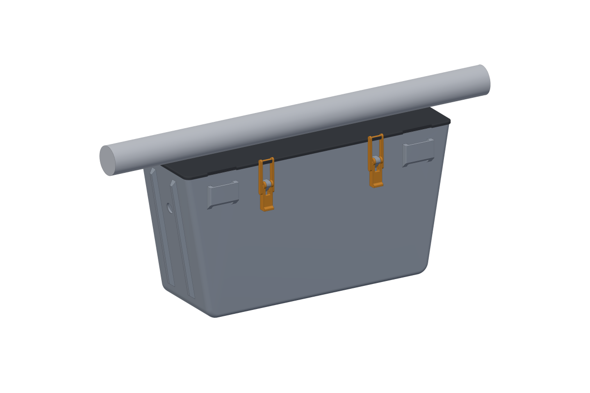
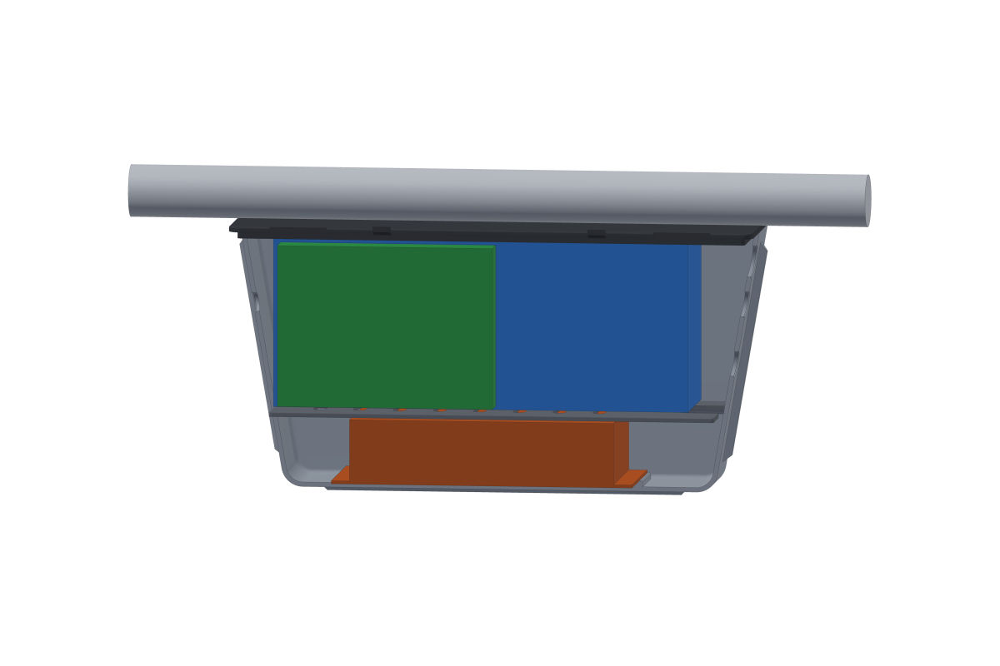
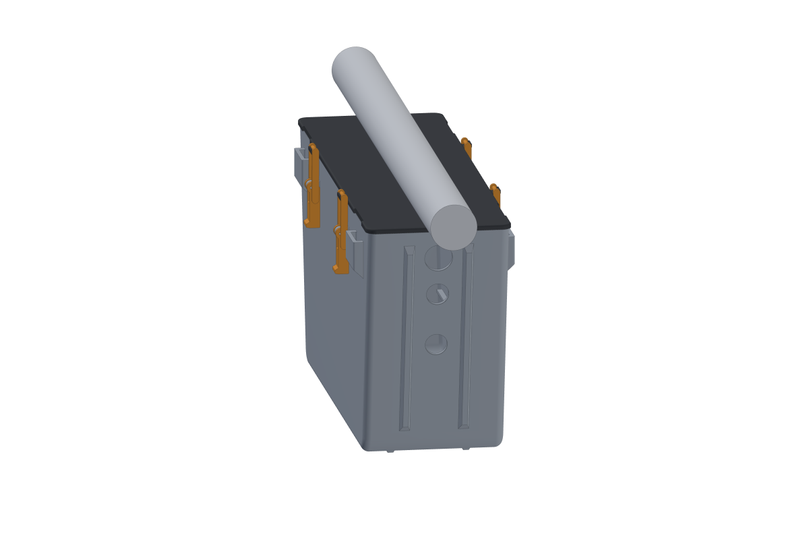
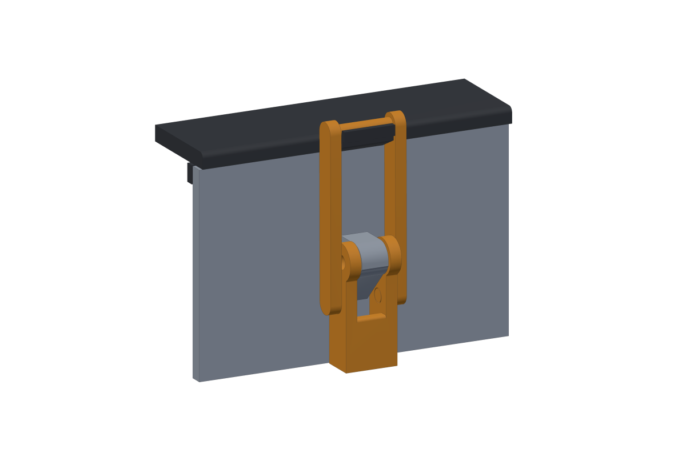

# Корпус АКБ + BMS + контроллер для электровелосипеда (Виталик)

Трапециевидный корпус в треугольник рамы. Подвешивается под верхнюю трубу на двух ремнях, продетых в пазы петель.
Крышка закрывается на 4 замка-«лягушки», как у ящика для инструментов.
Провода выходят назад, к сиденью, вверху торца — у самой трубы, и идут вдоль рамы.

Модель параметрическая, на [CadQuery](https://cadquery.readthedocs.io): все размеры заданы в начале `enclosure.py`.



| Разнесённый вид | Разрез (ближняя стенка убрана) |
|---|---|
|  |  |
| **Задний торец (к сиденью): выводы вверху** | **Замок-«лягушка»** |
|  |  |

## Исходные данные

| Что | Размер | Откуда |
|---|---|---|
| Корпус по эскизу | верх 340, низ 280, высота 160, ширина 100 мм | эскиз 1 |
| Аккумулятор 18650 | 270 × 110 × 73 мм | замер |
| BMS (на грани батареи) | 140 × 105 × 20 мм | замер, фото |
| Контроллер | 172 × 83 × 42 мм, ушки по 12 мм (итого 196) | эскиз 3 |
| Рёбра на торцах A/B и дне C | высота 5 мм, просвет 35 мм / отступ 20 мм | эскиз 1 |

## Конструкция

- **Форма.** Стенки и дно 3 мм одинаковой толщины. Все наружные рёбра скруглены: R6 по бокам, R14 внизу на торцах. Крышка со скруглённой кромкой.
- **Сверху отсек АКБ.** Батарея стоит **на боку**: поперёк велосипеда 73 мм вместо 110, коленям больше места.
  BMS остаётся прикрученной к батарее. Батарея сдвинута к переднему торцу, а за ней, у заднего торца, проходят провода вверх к выводу.
- **Полка-перегородка** (отдельная деталь). Лежит на уступах, у которых снизу скос 45° — уступы печатаются без поддержек.
  У заднего торца в полке вырез под провода, спереди вырез под палец, чтобы полку вынуть.
- **Снизу отсек контроллера.** Контроллер лежит плашмя на двух поперечных опорах и крепится саморезами 4.2 мм в пилотные отверстия.
  **Дно глухое**, сквозных отверстий нет — вода снизу не попадёт.
- **Крышка.** Центрирующий буртик по всему периметру, на кромке 4 зацепа под замки.
- **Замки-«лягушки» ×4.** Проушина на корпусе, рычаг с язычком под палец и серьга, которая заходит на зацеп крышки.
  Серьга проходит через мёртвую точку (~0.3 мм «щелчка»), поэтому замок держит сам и от тряски не открывается.
  При закрывании серьга натягивается на 0.3 мм и прижимает крышку.
- **Подвес.** 4 петли с пазами под ремень или липучку 25 мм. В свесе крышки на этих местах вырезы, чтобы ремень шёл прямо к трубе.
- **Выводы на заднем торце B** (к сиденью):
  вверху у трубы сальник **M20** под жгут контроллера, под ним **M16**, ниже гнездо зарядки **Ø16** (GX16).
  На переднем торце A — мембранный клапан **M12**. На всех отверстиях снаружи фаски.

### Итоговые размеры (из `out/dimensions.txt`)

- **ширина 103 мм** (эскиз — 100): батарея с BMS 93 + зазоры 2×2 + стенки 2×3;
- **высота 174 мм** (эскиз — 160): контроллер 42 на опорах 4 + полка + батарея на боку 110 + зазоры, дно и крышка;
- петли ремней и замки выступают на ~10 мм за боковые стенки.

Скрипт сам проверяет, что ничего ни с чем не пересекается: батарея, BMS, контроллер, полка, крышка, все детали замков,
а также ход рычага при открывании на 5–60°. Результат в `out/dimensions.txt`.

## Файлы

| Файл | Кол-во | Что это |
|---|---|---|
| `out/body.stl` | 1 | корпус |
| `out/lid.stl` | 1 | крышка |
| `out/shelf.stl` | 1 | полка |
| `out/latch_lever.stl` | 4 | рычаг замка |
| `out/latch_bail.stl` | 4 | серьга замка (уже с натягом 0.3 мм) |
| `out/*.step` | | те же детали для SolidWorks, FreeCAD и т. п. |
| `out/assembly.step` | | сборка с макетами батареи, BMS и контроллера |
| `enclosure.py` | | модель: параметры, геометрия, проверки, экспорт |
| `render_preview.py` | | картинки превью |

## Печать и сборка

- **Материал:** PETG или ASA. PLA на солнце поведёт. Стенки 3 мм — 4–5 периметров, заполнение 25–30 %.
- **Корпус** печатается открытой стороной вверх, без поддержек: уступы, петли и проушины сделаны со скосами 45°.
  **Крышка** печатается верхом вниз. **Полка** — плашмя.
- **Рычаг и серьгу** печатайте лёжа на боку (плоскость щёк на столе): так шипы и оси работают поперёк слоёв.
- **Метизы на 4 замка:** 4 оси Ø3 × 12 мм (пруток, гвоздь или винт M3×12 потайной, срезанный заподлицо).
  Серьга надевается на рычаг шипами со щелчком.
- **Контроллер:** 4 самореза по пластику 4.2 × 13.
- **Сальники:** M20 и M16 с гайками, мембранный клапан M12, разъём GX16.
- **Ограничение по столу:** корпус (344 мм), крышка (342) и полка (290) **не влезают в стол 256×256** (Bambu/Prusa).
  Нужен принтер со столом от 350 мм — или я разрежу корпус и крышку пополам с замковым стыком.

## Как пересобрать

```bash
pip install -r requirements.txt
```

```bash
python enclosure.py
```

Картинки (нужен Node.js с пакетом `playwright`):

```bash
python render_preview.py
```

## Что нужно уточнить

1. **Шаг отверстий в ушках контроллера.** Сейчас стоит 55 мм. Пилотные отверстия в опорах можно перенести, а при необходимости досверлить.
2. **Принтер:** есть ли стол от 350 мм, или резать корпус на две части?
3. **Ширина 103 / высота 174 мм — устраивает?** Если нужно уже: можно перенести BMS с батареи в торец отсека, тогда ширина будет ~83 мм.
4. **Диаметр верхней трубы** — чтобы подогнать петли и вырезы под ремни.
